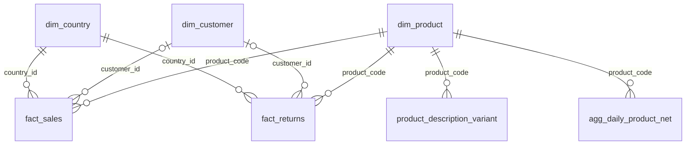

# Modelo de datos (esquema `dw`)

Diagrama editable: [`modelo_datos.dbml`](modelo_datos.dbml) (pégalo en <https://dbdiagram.io/d>). Vista rápida:

`rejected_records` y `etl_run_audit` son tablas de control sin llaves foráneas.

## Por qué este diseño
- **Estrella con dos tablas de hechos.** La regla de negocio exige separar ventas de devoluciones/ajustes
  (cantidad <= 0). `fact_sales` (cantidad > 0, precio > 0) y `fact_returns` (cantidad guardada en positivo,
  con `movement_type`) lo garantizan con `CHECK`, no solo con código. Así el neto es una resta de dos
  sumas y ninguna consulta puede mezclarlos por accidente.
- **Importes como columnas generadas** (`gross_revenue`, `returned_amount`, `invoice_date`, `is_anonymous`):
  PostgreSQL los calcula con aritmética decimal exacta; no pueden quedar inconsistentes con cantidad y precio.
- **`agg_daily_product_net`** guarda el revenue neto por producto y día UTC (requisito de la sección 5). Se
  reconstruye completo en cada carga. Es la base de Q1 a Q3.
- **`dim_product`** concentra lo decidido sobre el producto: nombre canónico, patrón de código, si es mercancía,
  categoría y su origen. `product_description_variant` conserva TODOS los textos vistos para auditar la
  elección del canónico y responder Q6.
- **Clientes anónimos** quedan con `customer_id` NULL (no se inventa un id): permite Q5 y no contamina `dim_customer`.
- **Clave natural única** (índices `ux_fact_*_natural_key`): el mismo hecho no puede existir dos veces.
- **`rejected_records`** guarda los valores ORIGINALES (texto) + motivo + fuente + línea del archivo.
